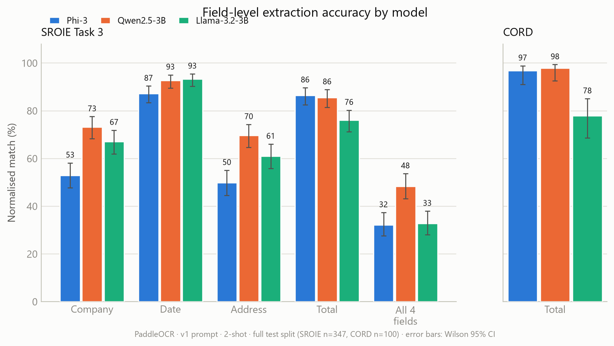
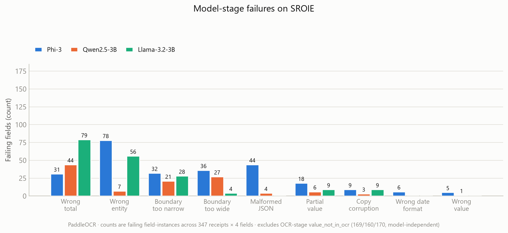
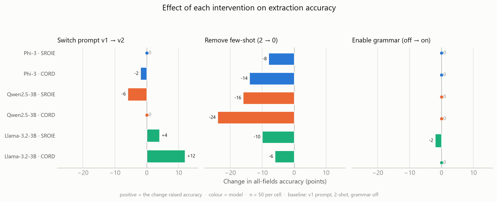
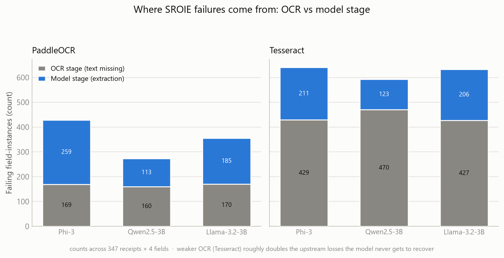

# Results

Full metrics and findings. For a one-screen summary see the
[README](../README.md#key-results-at-a-glance).

## Figures

Thesis-ready figures live in [`docs/figures/`](figures/) (PNG for preview, PDF
for LaTeX). They are generated from the committed result JSONs — see
[regenerating the figures](#regenerating-the-figures).

| Figure | Shows |
|---|---|
|  | Per-field and all-fields accuracy, three models, with Wilson 95 % CIs. |
|  | SROIE model-stage failure categories per model (Phi-3's malformed-JSON spike). |
|  | Accuracy change from each intervention (prompt v1→v2, few-shot 2→0, grammar off→on). |
|  | SROIE failures split into OCR stage vs model stage, PaddleOCR vs Tesseract. |

## Baseline setup

- Phi-3-mini-4k-instruct Q4 GGUF (llama-cpp-python, CPU), prompt `v1`,
  2-shot (SROIE train `X51005676545`, `X51005361946`; few-shot seed 42),
  temperature 0.
- **SROIE:** 50-receipt test subset `subset_test_50` (seed 42), run
  `20260930-063807`.
- **CORD v2:** 50-receipt validation + test subset `subset_valtest_50`
  (seed 42), run `20261027-183737`, with **CORD** few-shot examples (CORD
  train pool, seed 42). Only `total` is scored, normalised as rupiah.
- Intel 4-core/8-thread laptop CPU on AC power, fresh OCR (no cache), both
  runs from clean commits (SROIE `2e9c77a`, CORD `0684d6c`).

All percentages are over the 50 receipts. **[a–b] is the 95 % confidence
interval** (Wilson). With n = 50, intervals are about ±10–14 points, so small
differences between configurations are not meaningful on their own.

> **Scope note.** The Phi-3-only tables in this and the next section (both OCR
> engines, with fresh-OCR latencies) are the original **50-receipt** diagnostic.
> The headline three-model comparison now runs on the **full test split**
> (SROIE n=347, CORD n=100) — see
> [LLM comparison](#llm-comparison-ocr-fixed-to-paddleocr) below. The VLM
> ablation and the prompt/few-shot/grammar experiments also stay on the
> 50-receipt subset, as noted in their sections.

## SROIE Task 3

Normalised match % with 95 % CI (strict match % in brackets):

| Metric | PaddleOCR + Phi-3 | Tesseract + Phi-3 | OCR-free VLM ablation |
|---|---|---|---|
| Company | 44.0 [31–58] (36.0) | 44.0 [31–58] (38.0) | 78.0 [65–87] (68.0) |
| Date | 82.0 [69–90] (70.0) | 70.0 [56–81] (46.0) | 98.0 [90–100] (84.0) |
| Address | 42.0 [29–56] (6.0) | 34.0 [22–48] (8.0) | 82.0 [69–90] (40.0) |
| Total | 92.0 [81–97] (76.0) | 74.0 [60–84] (60.0) | 96.0 [86–99] (84.0) |
| **All 4 fields correct** | **26.0 [16–40]** | **18.0 [10–31]** | **62.0 [48–74]** |
| Token F1 company / address | 62.4 / 68.4 | 70.6 / 77.6 | 90.1 / 95.2 |
| Schema compliance (strict-valid) | 96.0 % [86–99] | 96.0 % [86–99] | 0.0 % [0–7] † |
| Latency / page, median / mean / p90 | 122 s / 150 s / 295 s | 51 s / 52 s / 66 s | 261 s / 284 s / 456 s |
| ↳ OCR, median / mean / p90 | 74 s / 104 s / 252 s | 1.0 s / 1.2 s / 2.0 s | — (no OCR stage) |
| ↳ LLM, median / mean / p90 | 44 s / 47 s / 57 s | 50 s / 51 s / 64 s | 261 s / 284 s / 456 s |

## CORD v2 total

Normalised match % with 95 % CI (strict match % in brackets):

| Metric | PaddleOCR + Phi-3 | Tesseract + Phi-3 ⚠️ | OCR-free VLM ablation |
|---|---|---|---|
| Total | 96.0 [86–99] (80.0) | 26.0 [16–40] (20.0) | 94.0 [84–98] (88.0) |
| Schema compliance (strict-valid) | 98.0 % [90–100] | 94.0 % [84–98] | 0.0 % [0–7] † |
| Latency / page, median / mean / p90 | 51 s / 76 s / 185 s | 9 s / 11 s / 20 s | 382 s / 335 s / 517 s |

The **OCR-free VLM** column is **Qwen2.5-VL-3B** reading the image (zero-shot);
the two text columns are **Phi-3** (2-shot). For the clean, same-family
controlled comparison — Qwen2.5-3B on OCR text vs Qwen2.5-VL-3B on the image —
see [OCR-free VLM ablation](#ocr-free-vlm-ablation) below.
† The VLM produces valid JSON on **100 %** of receipts but wraps it in prose, so
*strict*-valid (bare JSON only) is 0 %; schema-valid is 100 %.

**Dataset-matched few-shot examples matter.** An earlier CORD run
(`20260930-092942`) used the **SROIE** few-shot examples (English/Malay
receipts, ringgit). Switching to **CORD** examples (Indonesian, rupiah, with
`null` for the unlabelled company/date/address) improved PaddleOCR's total
from **84 % → 96 %** (LLM misses 8 → 2: fewer cash/subtotal confusions and no
1000× rupiah rescaling) and lifted schema compliance on Tesseract from
**68 % → 94 %** (the `null` examples stop the model writing prose on thin OCR).

⚠️ **Tesseract on CORD remains OCR-limited, not a fair baseline.** Its total
(26 %) is capped by OCR: the gold total is in Tesseract's text for only 34 %
of CORD receipts (33 of 50 are OCR misses), vs 96 % for PaddleOCR. A
diagnostic sweep of 11 preprocessing and page-segmentation settings
(`evaluation/datasets/CORD/diagnose_tesseract.py`,
[result](../evaluation/results/tesseract_diagnosis_CORD.json)) reached at best
36 % (grayscale `--psm 11`) vs 30 % for the current setting — binarisation and
upscaling did not help. CORD are phone photos (0.1–12 MP, perspective,
shadows); classic Tesseract cannot read them, and this is not a
language/preprocessing setup problem (the scored field is a number). Reported
for completeness, but the usable CORD pipeline is PaddleOCR.

## LLM comparison (OCR fixed to PaddleOCR)

The same prompt, run across three small Q4 GGUF models on CPU, on the **full
test split** (SROIE n=347, CORD n=100). This is the thesis's core comparison.
Runs `20261104-013736` / `20261105-012015` (phi3), `20261104-165458` /
`20261105-025355` (qwen2.5-3b), `20261104-212642` / `20261105-031508`
(llama3.2-3b).

**SROIE Task 3** (n=347): normalised match % (median LLM time below)

| Metric | Phi-3 Mini (3.8B) | **Qwen2.5-3B** | Llama-3.2-3B |
|---|---|---|---|
| Company | 53.0 | 73.2 | 67.1 |
| Date | 87.3 | 92.8 | 93.4 |
| Address | 49.9 | 69.7 | 61.1 |
| Total | 86.5 | 85.6 | 76.1 |
| **All 4 fields correct** | 32.3 [28–37] | **48.4 [43–54]** | 32.9 [28–38] |
| Token F1 company / address | 69 / 76 | 80 / 88 | 78 / 82 |
| Schema compliance (strict-valid) | 96.8 % | 99.7 % | **100 %** |
| LLM time / page, median | 40 s | 23 s | 20 s |

**CORD v2 total** (n=100): normalised match %

| Metric | Phi-3 Mini | **Qwen2.5-3B** | Llama-3.2-3B |
|---|---|---|---|
| Total | 96.8 [91–99] | **97.9 [93–99]** | 77.9 [69–85] |
| Schema compliance (strict-valid) | 99.0 % | 100 % | 100 % |
| LLM time / page, median | 10 s | 7 s | 6 s |

**Findings:**

- **Qwen2.5-3B is the best small model, despite being smaller than Phi-3**
  (3B vs 3.8B): SROIE all-4-fields **48 % vs 32 %**, CORD total **98 % vs
  97 %**, and ~2× faster. It trails Phi-3 only on the SROIE total (86 vs 87,
  within the confidence interval). **Model family matters more than size** at
  this scale.
- **Derailment is a Phi-3-specific failure mode.** Phi-3 produced invalid or
  truncated JSON on **44 field-instances** (the `MR. D.I.Y.` prompt-echo and
  similar). Qwen had 4 (a single malformed receipt on SROIE, 99.7 % valid) and
  Llama 0 (100 % valid); neither shows Phi-3's systematic derailment.
- **Multilingual ability shows on CORD** (Indonesian receipts): Qwen2.5-3B
  (strongly multilingual) **98 %**, Phi-3 97 %, **Llama-3.2-3B only 78 %**.
  Llama is competitive on SROIE but the weakest on CORD totals.
- Qwen and Llama both read **company and address better** than Phi-3
  (token F1 ~78–88 vs 69–76).

## OCR-free VLM ablation

A vision-language model reads the receipt **image directly** and outputs JSON,
replacing the OCR + LLM stages with one end-to-end step (`src/vlm.py`,
Qwen2.5-VL-3B via llama-cpp-python, CPU). The controlled comparison is
**Qwen2.5-3B fed OCR text vs Qwen2.5-VL-3B fed the image** — same family and
size, so the only difference is the OCR stage. It answers: *is a dedicated OCR
stage worth it, or should the model read the image itself?*

```bash
python -m src.vlm --manifest evaluation/datasets/SROIE/subset_test_50.jsonl
```

The VLM is **much slower on CPU** (~3–4 min/receipt; the vision encoder
dominates), zero-shot, with images capped at 1280 px. Results are scored by
the same `evaluate.py`. Both models emit valid JSON on every receipt, but the
VLM wraps it in prose (100% schema-valid, 0% strict); the text model emits bare
JSON (100% strict).

**Controlled comparison** (normalised accuracy, 50 receipts each):

| | SROIE all-4 | SROIE company | SROIE address | SROIE total | CORD total | median s/receipt |
|---|---|---|---|---|---|---|
| Qwen2.5-3B (OCR text) | 44% [31–58] | 60% | 66% | 88% | **100%** [93–100] | **102s** (SROIE) / **45s** (CORD) |
| Qwen2.5-VL-3B (image) | **62%** [48–74] | **78%** | **82%** | **96%** | 94% [84–98] | 261s (SROIE) / 382s (CORD) |

Reading the image directly **wins on messy receipts** (SROIE: +18 pts all-4,
led by address +16 and company +18 — OCR flattens layout, the VLM still sees
the header and multi-line address), but the **pipeline wins on clean receipts**
(CORD: 100% vs 94% — PaddleOCR reads a crisp printed total perfectly; the VLM
occasionally misreads a digit). The VLM costs 2.6×–8.5× more time on CPU.

A known trade-off beyond accuracy: the VLM is a **black box** — with no
intermediate OCR text, a wrong field cannot be attributed to reading vs
extraction, unlike the two-stage pipeline. The failure taxonomy is a
pipeline-only advantage.

## Where the misses come from (OCR vs LLM)

Phi-3, 50-receipt subset. OCR miss = the gold value is not in the OCR text at
all; LLM miss = the value was in the OCR text but wasn't extracted correctly.
(On the full test split the OCR-stage misses across the three models rise from
169/160/170 with PaddleOCR to 429/470/427 with Tesseract, while model-stage
misses stay in a similar range — see the miss-source figure.)

| Dataset / engine | Company OCR / LLM | Date OCR / LLM | Address OCR / LLM | Total OCR / LLM | Summary |
|---|---|---|---|---|---|
| SROIE / PaddleOCR | 15 / 14 | 5 / 6 | 16 / 13 | 2 / 3 | roughly **equal** |
| SROIE / Tesseract | 25 / 4 | 15 / 1 | 27 / 6 | 10 / 3 | mostly **OCR** |
| CORD / PaddleOCR | – | – | – | 2 / 2 | balanced (LLM misses were 8 with SROIE examples) |
| CORD / Tesseract | – | – | – | 33 / 4 | almost entirely **OCR** (OCR-limited, see above) |

"In the OCR text" is an automatic text search. It can count a label/print
difference (e.g. a label typo) as an OCR miss; these counts were checked
against the manual review in
[`taxonomy_v1.md`](../evaluation/failure_taxonomy/taxonomy_v1.md).

## Prompt and few-shot experiments (issue #24)

Two controlled experiments on branch `exp/m3`, same OCR (PaddleOCR, cached),
same models and 50-receipt subsets — only the prompt or the examples change.
Full write-ups and numbers:
[`prompt_v1_vs_v2.md`](../evaluation/results/prompt_v1_vs_v2.md) and
[`fewshot_2_vs_0.md`](../evaluation/results/fewshot_2_vs_0.md); tools:
`evaluation/compare_prompts.py`, `evaluation/compare_fewshot.py`.

**Prompt v1 vs v2** (v2 adds disambiguation rules: seller not buyer, final
total not cash, copy in full, null not prose) — a **model-dependent trade-off,
not a uniform win**:

| cell | all-fields v1 → v2 | note |
|---|---|---|
| CORD / Llama-3.2-3B | **78 → 90 (+12)** | `wrong_total` 10 → 5; the only shift clearly beyond the ±13-pt noise |
| SROIE / Phi-3 | 26 → 26 | **`malformed_json` 8 → 20** — the longer prompt destabilises the derailment-prone model |
| SROIE / Qwen2.5-3B | 44 → 38 | within noise (`boundary_too_wide` 5 → 9) |

Because it helps a capable model on its targeted weakness but hurts a fragile
one, **both prompts are kept with v1 as the default**.

**Few-shot: 2-shot vs 0-shot** (same v1 prompt, examples removed) — **removing
the examples is worse in all six cells** (−6 to −24 points), breaking more
receipts than it fixes everywhere. `wrong_total` rises throughout (CORD/Qwen
0 → 11, CORD/Phi-3 1 → 9): the examples were silently supplying the cash/total
and full-value semantics. The feared few-shot *copying* failure never appears
(`fewshot_copy` tag = 0 in both), so the examples are a pure gain. Combined
takeaway: **for these small models, concrete worked examples are a stronger,
safer lever than longer instructions.**

**Grammar-constrained decoding, off vs on** (issue #25; opt-in `--grammar` /
UI toggle, off by default). A GBNF built from the Receipt schema forces valid
JSON; empty pages short-circuit to all-null. Full write-up:
[`grammar_on_vs_off.md`](../evaluation/results/grammar_on_vs_off.md); tool:
`evaluation/compare_grammar.py`.

- **Guarantees valid JSON** for the stable models (Qwen, Llama stay 100%
  schema-valid by construction) and closed Phi-3's one clean gap on CORD
  (malformed 1 → 0, schema-valid 98 → 100).
- **Does not fix Phi-3's SROIE derailment** — it relocates it. The grammar
  forces `{"company": "…` and Phi-3 then spirals *inside* the string value until
  it truncates, because a JSON string may hold any text. Malformed receipts went
  2 → 3, not to 0.
- **No accuracy change** (format constraint, not a value constraint) and **~6×
  slower** generation. Takeaway: constrained decoding is a validity/safety
  property, and a syntactic constraint **cannot stop a model-intrinsic
  derailment** — the clean counterpart to the prompt result above.

## Notes

- The subsets are small (50 receipts): each receipt is 2 percentage points,
  hence the confidence intervals above.
- **Gold-label noise (SROIE).** Labels are used as released, with no manual
  corrections, and several SROIE gold labels carry scanner/transcription errors
  — `OLD TOWN KOPITAM SND BHD` (for *KOPITIAM SDN*), `SHAN ALAM` (for *SHAH
  ALAM*), `JALAN DLNARG U3/G` (garbled), `B1750 MASAI` (for *81750*), `SEITA
  ALAM` (for *SETIA*). On those receipts a **strict exact-match score
  under-counts correct extractions**, so the trusted measures here are the
  **normalised / lenient match and the manual review**, not strict match.
  The known cases are flagged in
  [`evaluation/datasets/SROIE/label_noise.jsonl`](../evaluation/datasets/SROIE/label_noise.jsonl)
  (8 (receipt, field) cases across 6 receipts, 5 of them in the test split),
  regenerated by `evaluation/datasets/SROIE/flag_label_noise.py`. Separately,
  5 duplicate-image groups carry conflicting labels, so a perfect extractor
  would not reach 100 %.
- The strict address score is low mainly because of comma, spacing and
  boundary differences. Normalised match and token F1 show how much of the
  address was right.
- Latency is measured with the model already loaded and the few-shot prompt
  prefix already read. It excludes model load (~4 s) and the one-off warm-up
  per engine (~70–100 s).
  - "About 2 minutes per receipt" is the **median**. The mean is 150 s, and
    1 receipt in 10 takes ≥ 295 s.
  - 9 of the 50 SROIE receipts are 35 MP scans, which take ~240–315 s of
    PaddleOCR each; they produce the long tail.
  - CORD prompts are shorter and the photos smaller, so CORD is faster.
- **Reproducibility:** an earlier run of the same SROIE subset
  (`20260930-030537`) produced **identical OCR text, identical raw LLM output
  and identical extracted fields for all 100 receipt × engine runs** (100/100
  each; both runs did fresh OCR). Only the timings differed: that run was
  partly on battery, and the laptop slept once.
  - Evidence: [`evaluation/results/reproducibility_20260930-030537_vs_20260930-063807.json`](../evaluation/results/reproducibility_20260930-030537_vs_20260930-063807.json)
    holds SHA-256 fingerprints per row (no receipt text) and the run settings
    of both runs.
  - To check yourself: `python evaluation/reproducibility.py <run_a> <run_b>`.
- Per-receipt results: [`evaluation/results/`](../evaluation/results/).

## Regenerating the figures

The figures are **data-driven**: nothing in them is hand-edited, so a new or
full-dataset run refreshes them without touching the plotting code. Two layers
keep the slow, run-dependent step separate from rendering:

```bash
pip install -r requirements-viz.txt        # matplotlib only
python evaluation/make_fulltest_data.py    # full-test run dirs -> *_full.json
python evaluation/make_figures.py          # committed JSONs -> docs/figures/*.png + *.pdf
```

`make_fulltest_data.py` needs the full-test run directories (gitignored) and
writes the committed `model_accuracy_full.json` and
`by_model_counts_full.json`. `make_figures.py` reads only committed JSONs: it
**prefers the `*_full.json`** (full test split) when present and otherwise falls
back to the n=50 `model_accuracy.json` / `by_model_counts.json`, plus the three
experiment JSONs for the intervention-delta figure (which stays on the
50-receipt subset). Re-rendering never needs the raw runs. The older
`figure_data.py` still regenerates the n=50 `model_accuracy.json`.
